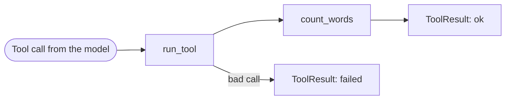

# agents-from-scratch
Building real AI agents in Python from scratch. The model chooses its tools and decides when to stop. Runs on a local Ollama model, tests first.

## Phase 1 plan: one agent, one tool


## The tool: count_words

The agent has one tool. It counts the words in some text. We chose it because the local model often miscounts words, and plain code counts exactly.

The model only asks for the tool. Our code decides whether to run it, checks the tool name and the arguments, and runs it. Every result comes back as a ToolResult with a status of ok or failed. A failed result holds a short error message that the model can read, so it can try again or give up.



## The loop: run_agent

run_agent is the agent. The model decides whether to call the tool or to answer. Our code runs the loop and sets the limits.

On each pass, our code sends the conversation and the tool description to the model. If the model answers in plain text, the run stops with the reason answered. If the model asks for the tool, our code runs it, adds the result to the conversation, and asks again. After 5 passes the run stops with the reason step_limit, whatever the model wants.

Every step is logged. The logs show tool names, argument names and result status. They never show the text a user sent.

To try it with Ollama running:

```
python3 -c "
import logging
logging.basicConfig(level=logging.INFO, format='%(message)s')
from agent.loop import run_agent
from agent.model import call_model
print(run_agent('How many words are in this sentence: the quick brown fox jumps over the lazy dog', call_model))
"
```
