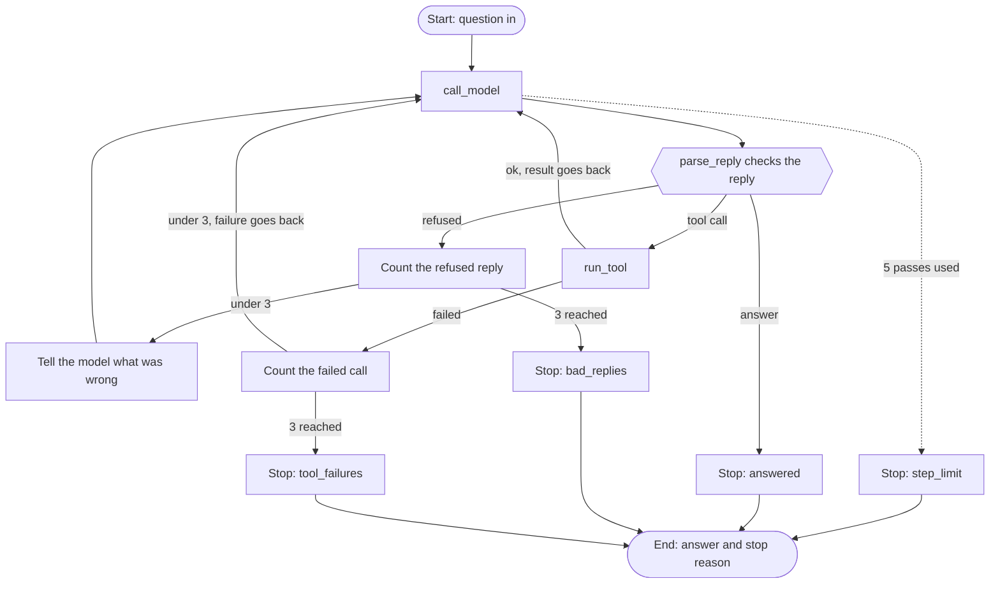

# agents-from-scratch
Building real AI agents in Python from scratch. The model chooses its tools and decides when to stop. Runs on a local Ollama model, tests first.

## Phase 1 plan: one agent, one tool


## The tool: count_words

The agent has one tool. It counts the words in some text. We chose it because the local model often miscounts words, and plain code counts exactly.

The model only asks for the tool. Our code decides whether to run it, checks the tool name and the arguments, and runs it. Every result comes back as a ToolResult with a status of ok or failed. A failed result holds a short error message that the model can read, so it can try again or give up.


## The loop: run_agent

run_agent is the agent. The model decides whether to call the tool or to answer. Our code runs the loop and sets the limits.

On each pass, our code sends the conversation and the tool description to the model. If the model answers in plain text, the run stops with the reason answered. If the model asks for the tool, our code runs it, adds the result to the conversation, and asks again. After 5 passes the run stops with the reason step_limit, whatever the model wants.

Every step is logged. The logs show tool names, argument names and result status. They never show the text a user sent.

To try it with Ollama running:

```
python3 -c "
import logging
logging.basicConfig(level=logging.INFO, format='%(message)s')
from agent.loop import run_agent
from agent.model import call_model
print(run_agent('How many words are in this sentence: the quick brown fox jumps over the lazy dog', call_model))
"
```

## Phase 2: checking what the model sends back

A model can send bad output. It can send a reply our code cannot read, ask for a tool that does not exist, or give a tool the wrong inputs. So our code treats every model reply as untrusted and checks it before acting on it.



parse_reply is the door. It refuses a reply that has the wrong shape, for example when the tool calls are not a list. When a reply is refused, the loop tells the model what was wrong and asks again. After 3 refused replies the run stops with the reason bad_replies.

A reply can have the right shape and still be a bad call, for example a tool that does not exist. run_tool sends back a failed result that names the real tools, so the model can try again. After 3 failed tool calls the run stops with the reason tool_failures.

The model decides when it is done. Our code decides when to cut it off. Every run ends with a named reason: answered, step_limit, bad_replies or tool_failures. Each limit is a small number at the top of agent/loop.py.

The tests use FakeModel, which can raise an error on cue, so no test calls a real model.
