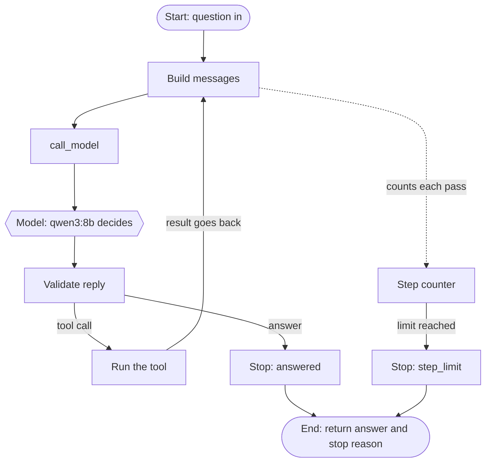

# agents-from-scratch
Building real AI agents in Python from scratch. The model chooses its tools and decides when to stop. Runs on a local Ollama model, tests first.

## Phase 1 plan: one agent, one tool

## The tool: count_words

The agent has one tool. It counts the words in some text. We chose it because the local model often miscounts words, and plain code counts exactly.

The model only asks for the tool. Our code decides whether to run it, checks the tool name and the arguments, and runs it. Every result comes back as a ToolResult with a status of ok or failed. A failed result holds a short error message that the model can read, so it can try again or give up.

